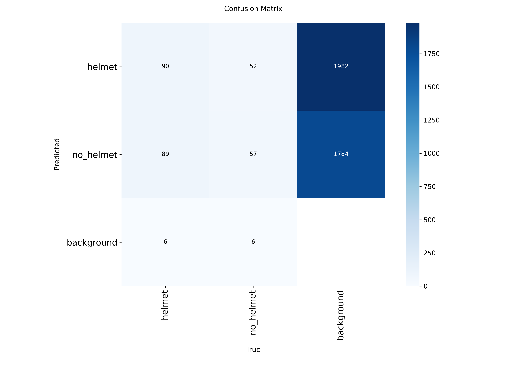
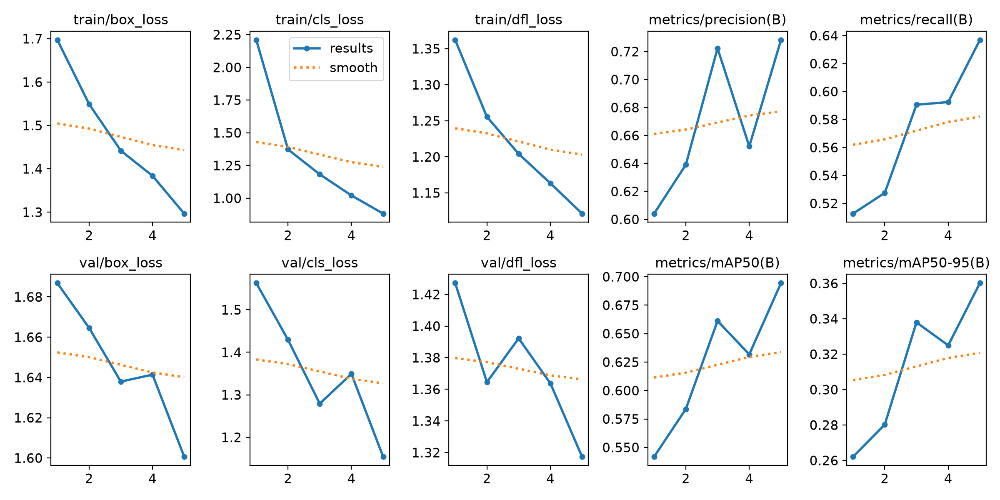

# HelmetWatch: Real-Time Helmet Detection

HelmetWatch is a real-time computer-vision pipeline that tells riders **with a helmet** from riders **without a helmet**. It combines a classical **OpenCV contour pipeline** with a **YOLOv8n** detector fine-tuned on two classes, served through a Flask back end and a single-file web interface (video upload or webcam).

Built during the **Progree Artificial Intelligence Internship** (Task 4).

| Metric | Result |
| --- | --- |
| mAP@0.5 (test) | **0.734** |
| F1 (test) | **0.692** |
| Offline speed | **19.3 FPS** (51.9 ms / image at 416 px) |
| Live web app | **6.0 FPS** (mean 136.5 ms server inference at 960 px) |

---

## Features

- **YOLO mode:** fine-tuned YOLOv8n (`best.pt`), default confidence 0.4, live inference at 960 px
- **Contour mode (classical baseline):** Gaussian blur, Gaussian adaptive threshold (block size 21, C = 5), external contours above a minimum area (400 px²), shape naming by polygon approximation (triangle, square, rectangle, circle, n-gon). Kernel size, block size and minimum area can be changed while the video runs
- Live **per-class count overlay** on every frame, e.g. `{helmet: 2, no_helmet: 1}`, with an alert when a rider has no helmet
- **Frame-by-frame metrics** recorded per frame and exportable as CSV
- Source: uploaded video file or webcam

## Requirements covered

| Requirement | Implementation |
| --- | --- |
| Real-time pipeline with OpenCV or YOLO | Flask back end running YOLOv8n or OpenCV on frames streamed from the web page |
| Adaptive threshold + Gaussian filter | Gaussian blur, Gaussian adaptive threshold, area-filtered contours |
| Overlay dynamic text counts per class | Per-class count vector drawn on every frame |
| Frame-by-frame metrics and whitepaper | Per-frame CSV log (1,176 frames) and `Task4_Whitepaper.docx` |

## System architecture

1. **Web page:** captures frames from a video or webcam, scales them to 640 px width and sends each as a JPEG (quality 0.8) to the back end.
2. **Flask back end** (`server.py`, endpoint `/api/detect`): runs the selected mode and returns boxes, labels, confidences, per-class counts, the number of no-helmet detections and its own latency.
3. **Web page again:** draws the boxes and count overlay and records one metrics row per frame.

## Dataset and training

- Dataset: [Helmet v9](https://universe.roboflow.com/helmet-detection-xy5ky/helmet-htftb) (Roboflow Universe, **CC BY 4.0**)
- An ambiguous "noise" class was removed, leaving 2 classes and 3,746 images
- Original train / val / test splits kept to avoid leakage between near-identical frames
- Trained from COCO-pretrained `yolov8n.pt` for **5 epochs** at 416 px, batch size 8

| Split | Images | helmet boxes | no_helmet boxes | Total boxes |
| --- | --- | --- | --- | --- |
| Train | 3,555 | 6,206 | 3,134 | 9,340 |
| Validation | 127 | 185 | 115 | 300 |
| Test | 64 | 124 | 63 | 187 |

## Results

**Detection metrics**

| Split | Precision | Recall | F1 | mAP@0.5 | mAP@0.5:0.95 |
| --- | --- | --- | --- | --- | --- |
| Validation | 0.728 | 0.637 | 0.680 | 0.694 | 0.360 |
| Test | 0.668 | 0.717 | 0.692 | 0.734 | 0.393 |

**Per class (test split)**

| Class | Precision | Recall | F1 | mAP@0.5 | mAP@0.5:0.95 |
| --- | --- | --- | --- | --- | --- |
| helmet | 0.834 | 0.798 | 0.816 | 0.889 | 0.511 |
| no_helmet | 0.502 | 0.635 | 0.561 | 0.580 | 0.276 |

`helmet` is detected well; `no_helmet` is clearly weaker (about half as many training boxes and more varied appearances such as bare heads, caps and scarves). The model is **under-trained rather than converged**: validation mAP@0.5 rose from 0.632 (epoch 4) to 0.694 (epoch 5) and losses were still falling.

### Real-time performance

Measured from `frame_metrics.csv`: 1,176 frames of a traffic video in YOLO mode (the 6,066 ms model warm-up frame is excluded).

| Metric | Value |
| --- | --- |
| Server inference: mean / median / p95 | 136.5 / 130.3 / 177.4 ms |
| Round-trip: mean / median / p95 | 149.5 / 143.1 / 192.6 ms |
| Throughput | 6.0 FPS average (lowest 3.9 FPS) |
| Detections per frame: mean / max | 1.3 / 4 |
| Frames with at least one `no_helmet` | 319 (27.1 %) |
| Offline benchmark (64 test images, 416 px) | 51.9 ms / image, 19.3 FPS |

The live rate is lower than the offline benchmark mainly because the live server decodes a JPEG and infers at 960 px, while the offline test used 416 px images. A smaller inference size or a GPU would raise FPS (accuracy would need to be re-measured).






## Project structure

```
HelmetWatch/
├── server.py             # Flask back end (/api/detect)
├── train_eval.py         # training + evaluation
├── prepare_dataset.py    # dataset preparation
├── make_whitepaper.py    # builds the whitepaper
├── index.html            # single-file front end
├── best.pt               # fine-tuned YOLOv8n weights
└── requirements.txt
```

## Getting started

```bash
git clone https://github.com/<your-username>/<repo-name>.git
cd <repo-name>/HelmetWatch
pip install -r requirements.txt
python server.py
```

Open <http://127.0.0.1:5000>, choose **YOLO** or **Contour** mode, then upload a video or start the webcam.

**Train the model**

```bash
python train_eval.py
```

## Limitations

- **Short training:** only 5 epochs; validation curves were still rising.
- **Weaker `no_helmet` class** (mAP@0.5 0.580 vs 0.889) and a 2:1 class imbalance.
- **Small test set:** 64 images / 187 boxes means wide uncertainty on every test metric.
- **Limited scene variety:** many frames come from a few fixed cameras, so scores probably overestimate performance on new angles and lighting.
- **Per-frame counts, not unique objects:** without a tracker the same rider is counted in every frame.
- **Small, distant riders** were missed in informal tests on crowded, elevated footage.
- The contour pipeline extracts shapes by pixel bounds; it cannot recognise a helmet and is only a classical baseline.

## Future work

- Train for more epochs and balance the classes
- Add a tracker such as ByteTrack for unique counts
- Test at a lower inference size or on a GPU

## Acknowledgements

- [Ultralytics YOLOv8](https://github.com/ultralytics/ultralytics) (Jocher, Chaurasia and Qiu, 2023)
- [OpenCV](https://opencv.org) (Bradski, 2000)
- Helmet v9 dataset, Roboflow Universe (CC BY 4.0)

## Author

**S Fatima Manzoor** (Progree AI Internship, 20 September - 20 October 2026)