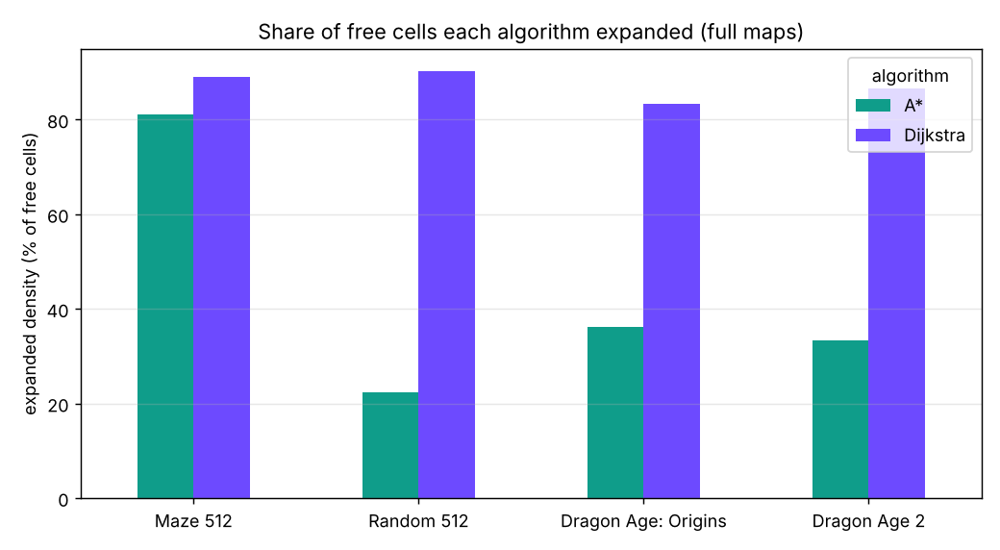
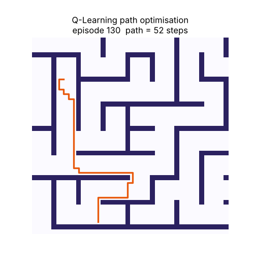
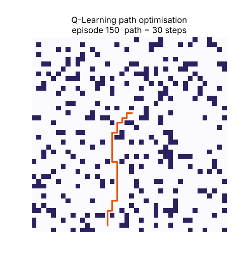

# Pathfinder: Heuristic Pathfinding Agent

Pathfinder is an optimisation search framework where virtual agents navigate grid mazes. **A\***, **Dijkstra** and **Q-Learning** are all implemented **from scratch**, benchmarked on the Moving AI Lab grid maps, and exposed through a Flask back end and an interactive web page.


| Metric | Result |
| --- | --- |
| Optimality check | **712 / 712** A\* and Dijkstra paths equal the BFS shortest distance |
| A\* vs Dijkstra (random maps) | A\* expanded **22 %** of free cells vs **90 %**, about **4.5x faster** |
| Q-Learning | Solved all 89 windows, exact optimum on 71, mean gap **1.2 %** |
| Logged runs | 801 across 89 maps |

---

## Features

- **Dijkstra**: priority queue on cost so far g(n)
- **A\***: same engine with f(n) = g(n) + h(n), h = Manhattan distance (admissible and consistent for 4-direction unit-cost moves, so paths stay optimal)
- **Q-Learning**: tabular RL agent that learns a policy by trial and error
- Benchmarks on 89 Moving AI maps: random maps (10 % to 64 % measured obstacles), mazes (corridor width 1 to 32) and Dragon Age game maps
- Tracks **step count, runtime, expanded nodes, expanded-node density** and the gap to the true optimum
- Exports CSV / JSON logs, PNG figures and GIF animations
- Interactive web page: map browser, wall painting, animated exploration, "Compare all three", run log, JSON / CSV / PNG export (JavaScript port of the algorithms)

## Requirements covered

| Requirement | Implementation |
| --- | --- |
| A\*, Dijkstra or Q-Learning from scratch | All three in `pathfinder/algorithms.py`, JS port in `static/index.html` |
| Test across varying obstacle arrays | 89 Moving AI maps with different obstacle densities and corridor widths |
| Track step count, runtime, expanded-node density | Logged for each of 801 runs, with gap to optimum |
| Export visualisation logs | CSV and JSON logs, PNG figures, GIFs in `results/`; export buttons in the web page |

## Q-Learning settings

| Setting | Value |
| --- | --- |
| State / actions | One state per free cell; 4 actions (up, down, left, right) |
| Rewards | +100 at goal, -1 per step, -5 for bumping into a wall |
| Learning rate / discount | alpha = 0.5, gamma = 0.99 |
| Exploration | epsilon decays from 1.0 to 0.05 over 250 episodes |
| Stopping rule | Greedy path tested every 10 episodes; stop when unchanged 6 times in a row |
| Reward shaping | Available but off (it pulled the agent into dead ends in mazes) |

## Dataset and setup

Maps come from the [Moving AI Lab grid-pathfinding benchmarks](https://movingai.com/benchmarks) (353 maps indexed, 89 used).

| Category | Maps | Description |
| --- | --- | --- |
| Maze | 60 | 512x512, corridor width 1, 2, 4, 8, 16 or 32 |
| Random | 70 | 512x512, nominally 10 % to 40 % obstacles |
| Dragon Age: Origins | 156 | Game maps, 49x49 up to about 970x650 |
| Dragon Age 2 | 67 | Game maps |

The experiment runs 267 full-map scenarios with A\* and Dijkstra, plus 89 windows of 40x40 cells with all three algorithms: **801 logged runs** in total.

Assumptions:

- Start / goal pairs are generated with a fixed seed (the official scenario files were not part of the download): a random cell in the largest connected region, with a goal at least 70 % of the maximum BFS distance away.
- Moves are 4-direction with cost 1 for every algorithm, so path lengths are comparable (the official benchmark uses 8-direction octile moves).
- Q-Learning runs only on 40x40 window crops; a Q-table for a 512x512 map (262,144 states) is impractical.

## Results

**40x40 windows, all three algorithms (means)**

| Category | Algorithm | Solved | Steps | Time (ms) | Expanded density | Gap to optimal |
| --- | --- | --- | --- | --- | --- | --- |
| Maze | A\* | 30/30 | 60.8 | 0.7 | 25.4 % | 0.0 % |
| | Dijkstra | 30/30 | 60.8 | 1.4 | 53.2 % | 0.0 % |
| | Q-Learning | 30/30 | 61.7 | 187.9 | 64.7 % | 1.5 % |
| Random | A\* | 35/35 | 44.0 | 0.7 | 21.7 % | 0.0 % |
| | Dijkstra | 35/35 | 44.0 | 1.9 | 81.4 % | 0.0 % |
| | Q-Learning | 35/35 | 44.4 | 192.3 | 96.5 % | 1.1 % |
| Dragon Age: Origins | A\* | 12/12 | 42.2 | 1.0 | 28.9 % | 0.0 % |
| | Dijkstra | 12/12 | 42.2 | 2.3 | 86.5 % | 0.0 % |
| | Q-Learning | 12/12 | 42.6 | 168.3 | 98.4 % | 0.9 % |
| Dragon Age 2 | A\* | 12/12 | 51.4 | 1.2 | 44.3 % | 0.0 % |
| | Dijkstra | 12/12 | 51.4 | 1.8 | 84.8 % | 0.0 % |
| | Q-Learning | 12/12 | 52.1 | 195.2 | 97.7 % | 1.2 % |

**Full maps (up to 971x649): A\* vs Dijkstra**

| Category | Runs | A\* (ms) | Dijkstra (ms) | A\* speed-up | A\* density | Dijkstra density |
| --- | --- | --- | --- | --- | --- | --- |
| Maze | 90 | 586 | 620 | 1.1x | 81 % | 89 % |
| Random | 105 | 128 | 581 | 4.5x | 22 % | 90 % |
| Dragon Age: Origins | 36 | 38 | 97 | 2.5x | 36 % | 83 % |
| Dragon Age 2 | 36 | 17 | 41 | 2.4x | 33 % | 86 % |

### Key findings

- **Same optimal paths, far less searching in open terrain.** On random maps A\* expanded 22 % of free cells vs 90 % for Dijkstra.
- **Mazes remove most of the advantage** (81 % vs 89 %): corridors force both searches to explore most of the map.
- **Obstacle density and corridor width change the cost.** From 10 % to 25 % obstacles, A\* expansion falls from 26 % to 12 %; near 64 % measured density paths stretch from about 560 to about 930 steps and A\* expands 49 %. In mazes the shortest path falls from about 4,500 steps (width 1) to about 2,000 (width 32).
- **Q-Learning** needed about 274 episodes (219,000 training steps), worst-case gap 14.3 %, and was roughly 230x slower than A\*.
- **Correctness:** every A\* and Dijkstra path length (712 runs) matches an independent breadth-first search.








## Project structure

```
pathfinder_project/
├── pathfinder/
│   ├── algorithms.py   # A*, Dijkstra, Q-Learning
│   └── dataset.py      # Moving AI map loading
├── benchmark.py        # runs the full experiment
├── app.py              # Flask back end
├── static/
│   └── index.html      # interactive web page
├── results/
│   ├── benchmark_log.csv / .json   # one row per map, scenario, algorithm
│   ├── summary_*.csv, summary.json # aggregated tables
│   └── figures/                    # PNGs and GIF animations
└── requirements.txt
```

## Getting started

```bash
git clone https://github.com/<your-username>/<repo-name>.git
cd <repo-name>/pathfinder_project
pip install -r requirements.txt
python app.py
```

Open <http://localhost:5000>.

**Run the benchmark**

```bash
python benchmark.py          # about 4 minutes
python benchmark.py --quick  # about 25-second test
```

## Limitations

- Tabular Q-Learning runs only on 40x40 windows (capped at 2,500 free cells).
- Generated start / goal pairs differ from the official scenario files, so results are not comparable with published Moving AI numbers.
- Runtimes are single runs of pure Python or JavaScript on one machine: relative values are meaningful, absolute values are not.

## Future work

- Use the official scenario files and 8-direction moves for comparison with published results
- Scale Q-Learning with function approximation

## Acknowledgements

- [Moving AI Lab](https://movingai.com/benchmarks): Sturtevant, N. R., *Benchmarks for Grid-Based Pathfinding*, IEEE TCIAIG, 2012
- Hart, Nilsson and Raphael (A\*, 1968); Dijkstra (1959); Watkins and Dayan (Q-learning, 1992)

## Author

**S Fatima Manzoor** (Progree AI Internship, 20 September - 20 October 2026)